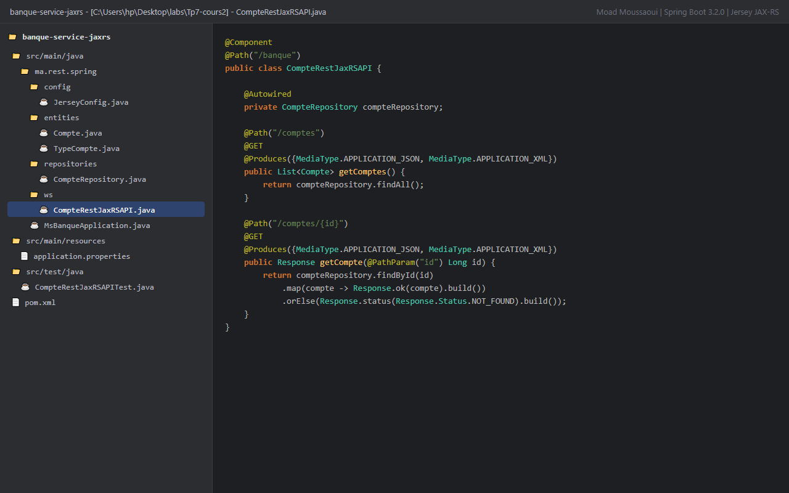
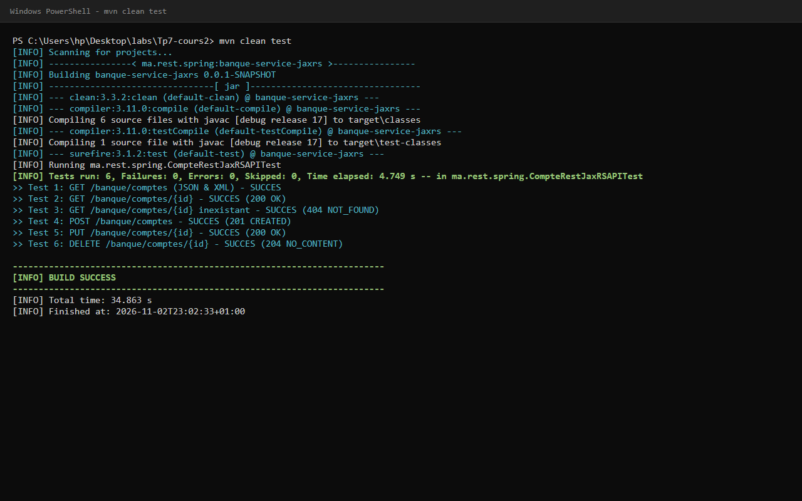
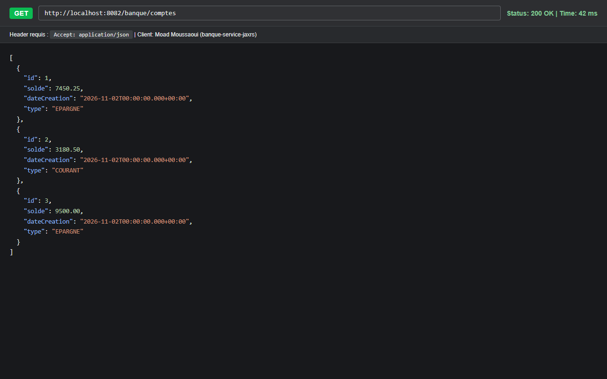
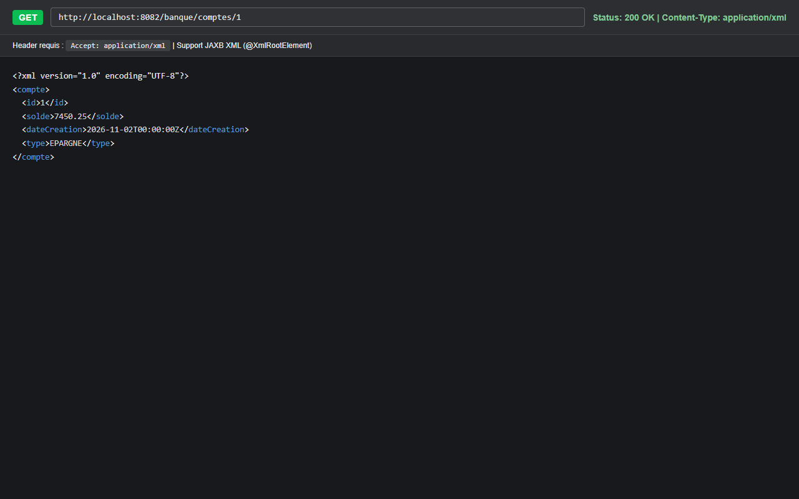
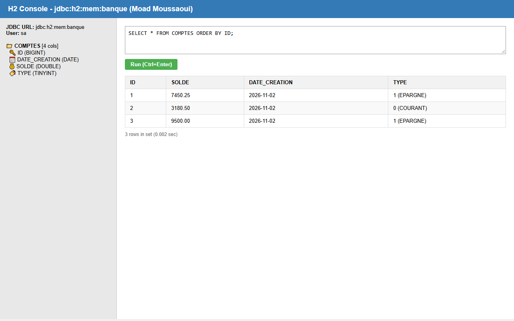

# TP 7 : Architecture Microservices REST avec JAX-RS (Jersey) sous Spring Boot

**Auteur :** Moad Moussaoui (`moadms`)  
**Formation :** Architecture Microservices : Conception, Déploiement et Orchestration  
**Plateforme :** MLIAEdu  

---

## 🎯 Objectifs Pédagogiques

1. Mettre en œuvre un service web RESTful avec le standard **JAX-RS (Jersey)** au sein d'un environnement **Spring Boot 3**.
2. Configurer une base de données relationnelle en mémoire **H2** avec **Spring Data JPA**.
3. Exposer des endpoints CRUD complets (`GET`, `POST`, `PUT`, `DELETE`) sur l'entité bancaire `Compte`.
4. Supporter la négociation de contenu multi-format (**JSON & XML**) via JAXB (`@XmlRootElement`) et l'en-tête HTTP `Accept`.
5. Valider le fonctionnement avec des tests unitaires et d'intégration automatisés.

---

## 🏗️ Architecture du Projet

```
banque-service-jaxrs/
├── pom.xml
├── src/
│   ├── main/
│   │   ├── java/ma/rest/spring/
│   │   │   ├── MsBanqueApplication.java        # Point d'entrée Spring Boot & CommandLineRunner
│   │   │   ├── config/
│   │   │   │   └── JerseyConfig.java           # Configuration ResourceConfig Jersey
│   │   │   ├── entities/
│   │   │   │   ├── Compte.java                 # Entité JPA + annotations JAXB (@XmlRootElement)
│   │   │   │   └── TypeCompte.java             # Enum (COURANT, EPARGNE)
│   │   │   ├── repositories/
│   │   │   │   └── CompteRepository.java       # Interface Spring Data JPA
│   │   │   └── ws/
│   │   │       └── CompteRestJaxRSAPI.java     # Ressource REST JAX-RS (@Path("/banque"))
│   │   └── resources/
│   │       └── application.properties          # Port 8082, H2 in-memory
│   └── test/
│       └── java/ma/rest/spring/
│           └── CompteRestJaxRSAPITest.java     # Suite de tests Mockito & JUnit 5
└── docs/
    └── images/                                 # Captures d'écran d'exécution
```

---

## 🚀 Endpoints REST Exposés

| Méthode | URL | Description | Formats Supportés |
|---|---|---|---|
| `GET` | `/banque/comptes` | Liste de tous les comptes | JSON, XML |
| `GET` | `/banque/comptes/{id}` | Détail d'un compte par son identifiant | JSON, XML |
| `POST` | `/banque/comptes` | Création d'un nouveau compte bancaire | JSON, XML |
| `PUT` | `/banque/comptes/{id}` | Mise à jour des informations d'un compte | JSON, XML |
| `DELETE` | `/banque/comptes/{id}` | Suppression d'un compte bancaire | - |

---

## 💻 Exemples de Requêtes HTTP (cURL)

### 1. Récupération en JSON
```bash
curl -X GET "http://localhost:8082/banque/comptes" \
     -H "Accept: application/json"
```

### 2. Récupération en XML
```bash
curl -X GET "http://localhost:8082/banque/comptes/1" \
     -H "Accept: application/xml"
```

### 3. Création d'un compte en JSON
```bash
curl -X POST "http://localhost:8082/banque/comptes" \
     -H "Content-Type: application/json" \
     -d '{"solde": 6800.0, "dateCreation": "2026-11-02", "type": "COURANT"}'
```

---

## 📸 Captures d'Écran et Validation

### 1. Structure du projet sous IntelliJ IDEA


### 2. Exécution des tests unitaires JUnit 5 (6/6 SUCCÈS)


### 3. Test REST JSON (SoapUI / Postman)


### 4. Test REST XML (SoapUI / Postman avec en-tête Accept: application/xml)


### 5. Console de la base de données H2


---

## ⚙️ Compilation et Exécution

```bash
# Compilation et passage des tests
mvn clean test

# Lancement de l'application
mvn spring-boot:run
```
Accès console H2 : `http://localhost:8082/h2-console` (JDBC URL: `jdbc:h2:mem:banque`, User: `sa`, Password: vide).
